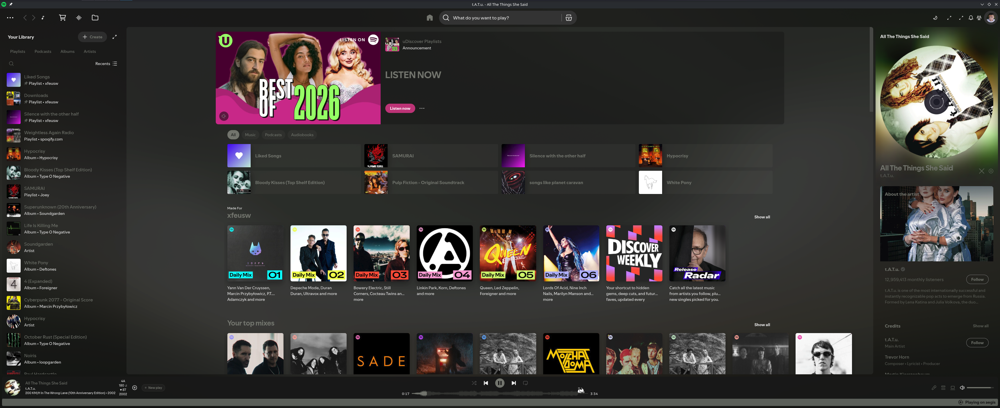

# spotify-custom

Spicetify setup for NixOS and Home Manager on top of
[spicetify-nix](https://github.com/Gerg-L/spicetify-nix): theme, extensions, custom apps and
snippets behind one option.



## Usage

```nix
inputs.spotify-custom = {
  url = "github:xfeusw/spotify-custom";
  inputs.nixpkgs.follows = "nixpkgs";
};
```

```nix
{ inputs, ... }:
{
  imports = [ inputs.spotify-custom.nixosModules.default ];
  # or homeManagerModules.default
  spotify-xfeusw.enable = true;
}
```

Don't also import `spicetify-nix`'s module in the host; this one already does.

Other `programs.spicetify.*` options still work. List options append; `theme` needs `lib.mkForce`.
